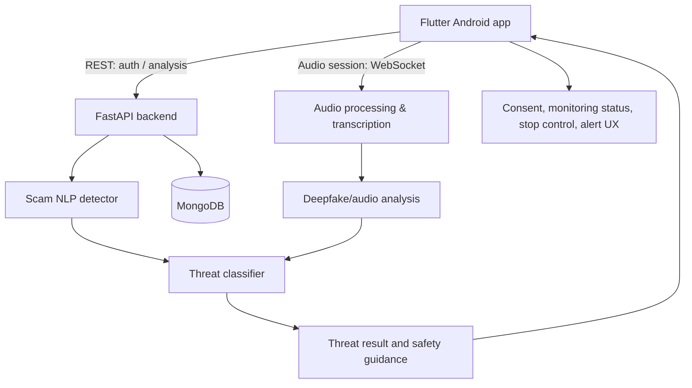

# Phase 9 — Final Handover

**Project:** EchoShield — Real-Time AI Scammer Interceptor  
**Repository:** https://github.com/utsavdhakre-Xplorer/EchoShield  
**Handover scope:** Codebase overview, local setup, operational configuration, validation commands, known limitations, and release gate.

## 1. Project overview

EchoShield is a student project that combines a Flutter client, FastAPI backend, MongoDB persistence, speech transcription, audio deepfake analysis, NLP scam-signal detection, threat classification, and a negotiator strategy component. The client includes dashboard/call-monitor UX and an Android CallScreeningService feasibility scaffold.

This handover describes the repository as implemented. It does **not** claim production-grade scam interception, validated model accuracy, completed physical-device QA, or a deployed live service.

## 2. Architecture and data path



Relevant code areas:
- `backend/app/main.py`: FastAPI app, production configuration gates, middleware.
- `backend/app/api/`: authentication, audio, analysis and WebSocket API routes.
- `backend/app/core/`: database lifecycle and security helpers.
- `backend/app/services/`: transcription, deepfake/scam detection, threat classification and negotiator.
- `backend/app/ml/`: audio features and NLP/model integration.
- `backend/ml_training/`: dataset processing, training/testing scripts and saved classifier artifacts.
- `flutter-app/lib/`: Flutter screens, services and alert/dashboard widgets.
- `flutter-app/android/app/src/main/`: Android manifest and call-screening feasibility implementation.
- `web-dashboard/`: browser dashboard.
- `.github/workflows/`: backend tests, Flutter checks, Android debug APK workflow.

## 3. Local development setup

### Backend (Windows PowerShell)

Use Python 3.11. From repository root:

```powershell
cd backend
.\setup.ps1
# Copy .env.example to .env if setup did not create it, then edit .env
.\setup.ps1 -SkipInstall -RunServer
```

Backend default local address is `http://localhost:8000`. Check:
- `GET /health` — liveness check.
- `GET /ready` — readiness check, requires database connectivity.
- API documentation is available in development configuration when enabled.

Backend tests:

```powershell
cd backend
.\test.ps1
```

### Flutter

Install Flutter SDK and Android tooling, then:

```powershell
cd flutter-app
flutter pub get
flutter analyze
flutter test
flutter run --dart-define=API_BASE_URL=http://10.0.2.2:8000
```

`10.0.2.2` is the Android emulator's host-machine loopback alias. For a physical phone, configure API_BASE_URL to a reachable backend address; for release environments use HTTPS/WSS endpoints.

Build internal QA APK:

```powershell
flutter build apk --debug --dart-define=API_BASE_URL=<backend-url>
```

The CI workflow builds and uploads a debug APK artifact (artifact retention is configured in the workflow). Debug artifacts are for QA and are not Play Store release packages.

### Docker Compose

Configure `backend/.env` with valid required settings, then from repository root:

```bash
docker compose up --build
docker compose logs -f
docker compose down
```

Compose provides local MongoDB, backend, and web-dashboard services. The backend service's Compose environment points to the Compose Mongo service.

## 4. Configuration and secret handling

Start from `backend/.env.example`. Key settings include:
- `MONGO_URI`: persistent MongoDB connection string.
- `JWT_SECRET_KEY`: strong, unique random secret; never use the example placeholder.
- `JWT_EXPIRE_MINUTES`: token expiration duration.
- `WHISPER_MODEL`: transcription model size.
- `DEEPFAKE_MODEL_PATH` and `DEEPFAKE_THRESHOLD`: optional model path and decision threshold.
- `ANTHROPIC_API_KEY`, `TELEGRAM_BOT_TOKEN`, `TELEGRAM_CHAT_ID`: optional integrations.

Never commit actual credentials, production URLs containing secrets, private keys, signing keys, or user recordings/transcripts. Use hosting-provider secret storage. Production mode requires a connected persistent MongoDB and configured exact CORS origins; mock database fallback and interactive API docs are not enabled in production configuration.

## 5. CI and verification

Workflows currently included:
- Backend unittest workflow on relevant branch/PR events.
- Flutter analyze/test and Android debug APK build/artifact workflow.
- Flutter checks workflow.

Run the local commands in Section 3 before submitting changes. Check the GitHub Actions page for the actual latest run state; a workflow definition being present is not evidence that its latest run passed.

## 6. Phase completion record

| Phase | Scope | Repository status |
|---|---|---|
| 1 | Backend environment | Completed in project history |
| 2 | Database and APIs | Completed in project history |
| 3 | Flutter app reliability | Completed; PR #4 merged |
| 4 | AI/ML integration | Completed; PR #5 merged |
| 5 | Android integration feasibility | Completed; PR #6 merged |
| 6 | Real-time protection UX and safety | Completed; PR #7 merged |
| 7 | Security, privacy and operational readiness | Code/docs changes merged; operator tasks remain |
| 8 | Testing and deployment automation | CI workflow and QA protocol merged; handset QA remains manual |
| 9 | Final handover | This document is the handover record |

## 7. Known limitations and release gates

**Do not treat this repository as a public production release until the following are addressed and verified:**

1. Complete the target Android handset QA checklist in `docs/PHASE_8_TESTING_DEPLOYMENT.md`. Record device, Android version, build SHA, backend endpoint, date, pass/fail, and issue references. This must be performed by a person with the target phone; it cannot be completed by remote repository edits.
2. Replace debug signing with a secure release-signing configuration. Keep signing credentials outside Git.
3. Remove development cleartext allowance and confirm client/server use HTTPS and WSS end-to-end.
4. Deploy backend and dashboard with TLS, production secrets, exact CORS allowlist, monitoring, and appropriately configured API gateway/rate limits.
5. Validate MongoDB backup and restore, define retention/deletion policy, and obtain appropriate privacy/legal review for processing voice/audio/transcript data.
6. Evaluate model accuracy on a representative, documented dataset; review false positives/false negatives and model limitations.
7. Review Android permissions, call-screening role behavior, OEM/background/battery constraints, and platform distribution requirements.

The Android CallScreeningService is a feasibility scaffold and does not promise automatic detection or blocking of scam calls. Threat scores are heuristic/model outputs and must not be presented as certainty. Do not test with sensitive real calls or expose credentials/transcripts in logs.

## 8. Handover checklist

- [x] Repository overview and component map documented.
- [x] Local backend, Flutter, and Compose commands documented.
- [x] Configuration and secret handling summarized.
- [x] CI workflow types and verification commands documented.
- [x] Known boundaries and release blockers explicitly listed.
- [ ] Physical handset QA performed and results recorded.
- [ ] Production hosting, TLS, signing, backup/restore, rate limits, and privacy review completed by operators.

**Handover outcome:** The code and documentation are organized for project transfer and continued QA. Operational deployment and physical device validation remain outstanding and are intentionally not marked complete.
